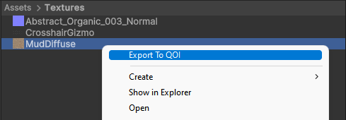
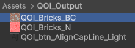
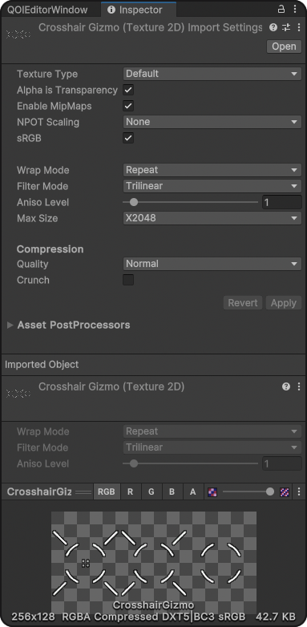

 
## QOI Image Format Importer & Exporter for Unity


[](https://openupm.com/packages/com.ltmx.unity.qoi/)
[](https://unity3d.com)

<!--
<br>

<br>
-->

## Features

- **No dependencies**: a single self contained codec, nothing to install besides this package
- Imports `.qoi` files as textures (RGB & RGBA, sRGB / linear, mipmaps, max size, DXT / BC7 / Crunch compression, sprites)
- Exports any `Texture2D` to QOI / PNG / JPG / EXR / TGA, even non readable and compressed ones
- Bit exact with the reference [qoi.h](https://github.com/phoboslab/qoi) encoder
- Runtime API (works in builds, not only in the editor)
- **Seekable QOI**: optional, 100% spec compliant variant that decodes on all CPU cores or on the GPU
- **Compute shader encoder / decoder** (`QoiGpu`)

```csharp
using LTMX.QOI;

byte[] qoi = anyTexture.EncodeToQOI();              // any Texture, readable or not
Texture2D tex = QoiTexture.LoadQOI(qoi);             // CPU decode + upload
existingTexture2D.LoadQOI(qoi);                      // like ImageConversion.LoadImage

byte[] seekable = QoiGpu.Encode(renderTexture);      // GPU encode, only the compressed bytes are read back
QoiGpu.EncodeAsync(renderTexture, bytes => ...);     // same, without stalling the main thread
RenderTexture gpuTex = QoiGpu.Decode(seekable);      // GPU decode, pixels never touch the CPU
QoiGpu.TryDecodeInto(seekable, existingUNormRT);     // same into a reused render texture: no allocation, fastest
Texture2D gpuTex2D = QoiGpu.DecodeToTexture2D(seekable); // same, as a Texture2D (slower: Unity allocates a CPU copy)
QoiGpu.ReleaseResources();                           // frees the pooled GPU buffers

QoiImage img = QoiCodec.Decode(bytes, outputChannels: 4, flipY: true); // raw codec, no UnityEngine needed
byte[] file = QoiCodec.Encode(rgba, width, height, 4, QoiChannels.Rgba, seekChunkPixels: QoiCodec.DefaultChunkPixels);

anyTexture2D.SaveToFile(TextureEncodingFormat.QOI);  // editor: opens a native save panel
```

Run `Tools > QOI > Run Self-Test` to check the CPU and GPU codecs against each other and benchmark them on your machine.

### Seekable QOI
QOI is sequential: every pixel depends on the previous one and on a 64 entry color table, which prevents parallel decoding.
A seekable file splits the image into chunks of N pixels (4096 by default). Each chunk starts with a `QOI_OP_RGBA`,
never continues a run from the previous chunk and never references a table entry written before it.
The op stream stays a perfectly standard QOI stream, so **any QOI decoder reads these files**,
but each chunk can also be decoded on its own. A small trailer stored after the end marker lists the byte offset of every chunk:

```
header | ops | end marker | u32 offsets[chunkCount] | u32 chunkPixels | u32 chunkCount | "qsek" | end marker
```

The size overhead is about 9 bytes per chunk (≈0.1% on typical images).
The importer decodes seekable files on all cores, `QoiGpu` decodes them with one GPU thread per chunk.

### Compute shader codec
- **Encode**: a first pass with one thread per chunk only measures the size of every chunk, a prefix sum turns the
  sizes into byte offsets, then a second pass writes every chunk straight at its final (unaligned) offset. Encoding
  twice is cheaper than compacting scratch copies, and the ops are read back directly into the returned file.
  Works on any GPU texture (render textures, compressed, HDR...) and its output is byte identical to the CPU seekable encoder.
- **Decode**: one thread per chunk replays the ops (reading 32 bit words, not bytes) and writes into a random write
  render texture, raw-copied into an sRGB one when needed. No pixel data goes through the CPU, and the upload
  writes the op stream straight into GPU visible memory.
- GPU buffers are pooled (guarded by GPU fences) so repeated calls don't reallocate. Files encoded on the GPU use
  1024 pixel chunks: more GPU threads when decoding, for ~0.4% size.
- 4096x4096 on an RTX 4070, including upload / readback and waiting for the GPU: GPU encode ~14 ms (CPU ~190 ms),
  GPU decode ~16 ms, ~11 ms into a reused render texture (CPU parallel ~35 ms, single thread ~190 ms).
- Plain (non seekable) files and machines without compute shaders fall back to the CPU codec.

<table>
    <tr>
      <td>
        <a href="selftitled.html">
          <div class="imgWrap floatleft">
            <h3>Context Menu Action</h3>
            
          </div>
        </a>
      </td>
      <td>
        <a href="12x5.html">
          <div class="imgWrap floatleft">
            <h3>Output Folder</h3>
            
          </div>
        </a>
      </td>
    </tr>
  </table>


### Importer Inspector Parameters
Most settings have been mapped from how unity imports other image formats, to ensure behaviour compatibility




<!--
### Editor Window


-->
    
## Installation
### UNITY PACKAGE MANAGER (recommended)
1. Copy this URL: ``https://github.com/LTMX/Unity.QOI.git``
2. In Unity menu bar, go to ``Window > Package Manager`` [Help](https://docs.unity3d.com/Manual/Packages.html)
3. In Unity Package Manager, click ``(+ button) > Add package from Git URL...`` (info / troubleshooting Git URL packages in Unity)
4. Paste URL from step 1 into the URL box and click ``Add``
5. Unity.QOI will now automatically update from GitHub
### Zip Package From Releases
- Or manually download the latest .ZIP from [Releases](https://https://github.com/LTMX/Unity.QOI/releases)
    and unzip to `/<your project folder>/Packages/com.ltmx.unity.qoi/`


## Contribute
- please post bug reports or (small) feature requests as an [Issue](https://github.com/LTMX/Unity.QOI/issues)
- [Pull Requests](https://github.com/LTMX/Unity.QOI/pulls) are welcome and encouraged !

## Credits
- [QOI Image Format](https://github.com/phoboslab/qoi)
- Earlier versions used [qoi.csharp](https://github.com/kroppt/qoi.csharp) and [QoiSharp](https://github.com/alanmcgovern/QoiSharp), since replaced by a built-in codec

- <a href="https://github.com/Ben1138/unity-qoi">Importer from Ben1138, though modified a lot</a>

## LICENSE
<p>This project is licensed under the MIT License (<a href="LICENSE">License</a>)</p>
