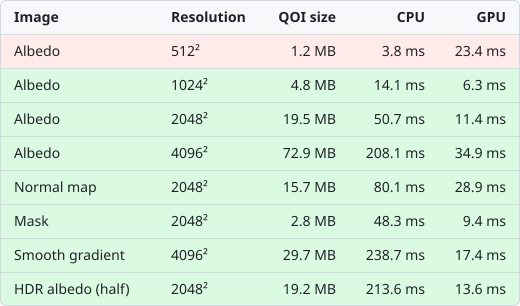
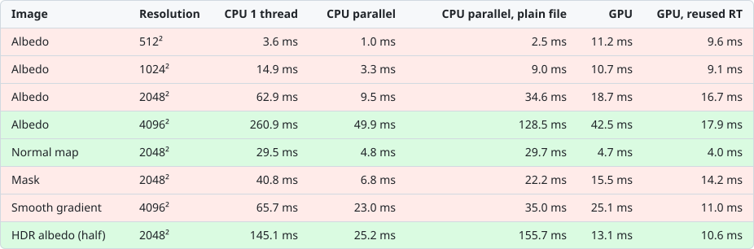

## QOI Image Format Importer & Exporter for Unity


[](https://openupm.com/packages/com.ltmx.unity.qoi/)
[](https://unity3d.com)

<!--
<br>

<br>
-->

Fast [QOI](https://qoiformat.org) import / export for Unity, on the CPU or the GPU.

## Features
- **No dependencies**, runtime and editor
- Bit exact with the reference [qoi.h](https://github.com/phoboslab/qoi)
- **GPU encoder / decoder** (compute shaders), up to 16× faster than the CPU
- **Seekable QOI**: still readable by any QOI decoder, decodes on all cores or on the GPU
- **HDR (half / float) and single channel** extensions, lossless
- Importer: sRGB / linear, mipmaps, max size, NPOT scaling, DXT / BC4 / BC6H / BC7 / Crunch, sprites, **cubemaps**
- Exporter: any `Texture2D` (non readable and compressed included) to QOI / PNG / JPG

## Installation
Unity **2022.3+**. In `Window > Package Manager`, click `+ > Add package from git URL...` and paste:
```
https://github.com/LTMX/Unity.QOI.git
```
Or unzip a [release](https://github.com/LTMX/Unity.QOI/releases) into `Packages/com.ltmx.unity.qoi/`.

## Quick start
```csharp
using LTMX.QOI;

byte[] qoi = texture.EncodeToQOI();                   // CPU, any Texture
Texture2D tex = QoiTexture.LoadQOI(qoi);              // CPU decode

byte[] seekable = QoiGpu.Encode(texture);             // GPU encode
RenderTexture rt = QoiGpu.Decode(seekable);           // GPU decode, pixels never touch the CPU
```

<details>
<summary>Full API</summary>

```csharp
// Textures (CPU)
byte[] hdr = texture.EncodeToQOI(sampleFormat: QoiSampleFormat.Half, channels: QoiChannels.Rgb); // force a format
existingTexture2D.LoadQOI(qoi);                        // like ImageConversion.LoadImage

// GPU encode
QoiGpu.EncodeAsync(texture, bytes => ...);             // callback a few frames later (needs the player loop)
using var request = QoiGpu.RequestEncode(texture);     // poll it yourself: editor loops, batch mode
request.WaitForCompletion();                           // or request.Update() until request.Done
request.WriteTo(fileStream);                           // no managed array

// GPU decode (non seekable files fall back to the CPU)
QoiGpu.TryDecodeInto(seekable, existingUNormRT);       // reused render texture: fastest
Texture2D tex2D = QoiGpu.DecodeToTexture2D(seekable);  // slower: Unity allocates a CPU copy
QoiGpu.ReleaseResources();                             // frees the pooled GPU buffers

// Raw codec (no UnityEngine)
QoiImage img = QoiCodec.Decode(bytes, outputChannels: 4, flipY: true);
byte[] file = QoiCodec.Encode(rgba, width, height, 4, QoiChannels.Rgba, seekChunkPixels: QoiCodec.DefaultChunkPixels);
byte[] halfFile = QoiCodec.Encode(halfBits /* ushort[] or float[] */, width, height, 4, QoiChannels.Rgba);
Span<ushort> halfs = QoiCodec.Decode(halfFile).AsHalfs(); // AsFloats() for float files
bool isSeekable = QoiCodec.IsSeekable(bytes);

// Editor
texture2D.SaveToFile(TextureEncodingFormat.QOI);       // native save panel
```
</details>

## Editor
- **Import**: drop `.qoi` files in the project. Cubemaps: set *Texture Shape* to *Cube*. The layout is detected from the
  image ratio (2:1 lat-long, 6:1 / 1:6 strip in +X −X +Y −Y +Z −Z order), or you can pick it.
- **Export**: right click a texture > `Export to...`, or `Window > QOI Export Window` (CPU / GPU encoder, sample format, channels).
- **Self-test**: `Tools > QOI > Run Self-Test` checks CPU and GPU byte for byte and benchmarks your machine.

 

## Performance
RTX 4070 (D3D12), Xeon W-2135 (6c / 12t), Unity 7000.0, Release code optimization. GPU times include upload / readback.
Green rows: the GPU is faster, red rows: the CPU is faster.

**Encode**



**Decode** (GPU compared with the parallel CPU decode)



Editor scripts default to Debug code optimization, which makes the CPU codec ~3× slower. Switch to Release in the status bar for faster imports.

## Format

| File | Other QOI decoders | This package |
|---|---|---|
| 8 bit RGB / RGBA | ✅ | ✅ |
| Seekable | ✅ | ✅ multithreaded / GPU |
| Single channel, HDR | ❌ rejected cleanly | ✅ |

<details>
<summary>Seekable QOI</summary>

The image is split into chunks of N pixels (4096 on the CPU, 1024 for GPU encodes). Each chunk starts with a
`QOI_OP_RGBA`, never continues a run and never references a color table entry written before it, so it decodes on its own
while the stream stays standard QOI. A trailer after the end marker lists the chunk offsets (≈0.1–0.4% overhead):

```
header | ops | end marker | u32 offsets[chunkCount] | u32 chunkPixels | u32 chunkCount | "qsek" | end marker
```
</details>

<details>
<summary>HDR and single channel</summary>

- Header channel byte: `channelCount | sampleFormat << 4`, channel count 1, 3 or 4, sample format 0 (8 bit), 1 (half), 2 (float).
- **Single channel**: index and run ops, `0x40 | (d + 32)` for a difference in [-32, 31], `0xFE v` for a literal.
- **HDR**: raw half / float bits (lossless, NaN included) split into byte planes, most significant first, encoded
  like an 8 bit image 2 or 4 times taller. Every op, seekable chunks and GPU decoding work unchanged.
- Formats are picked from the texture (R8 / RHalf / RFloat… → R, half / BC6H → half, float / 16 bit → float).
</details>

<details>
<summary>GPU codec</summary>

- **Encode**: pass 1 measures every chunk (one thread per chunk), a prefix sum gives the offsets, pass 2 writes every
  chunk at its final offset. Output is byte identical to the CPU seekable encoder.
- **Decode**: one thread per chunk writes into a random write render texture (raw-copied to sRGB when needed).
- GPU buffers are pooled. Non seekable files and machines without compute shaders use the CPU codec.
</details>

## Contribute
- Please post bug reports or (small) feature requests as an [Issue](https://github.com/LTMX/Unity.QOI/issues)
- [Pull Requests](https://github.com/LTMX/Unity.QOI/pulls) are welcome and encouraged!

## Credits
- [QOI Image Format](https://github.com/phoboslab/qoi)
- Earlier versions used [qoi.csharp](https://github.com/kroppt/qoi.csharp) and [QoiSharp](https://github.com/alanmcgovern/QoiSharp), since replaced by a built-in codec
- <a href="https://github.com/Ben1138/unity-qoi">Importer from Ben1138</a>, though modified a lot

## License
This project is licensed under the MIT License ([License](LICENSE))
